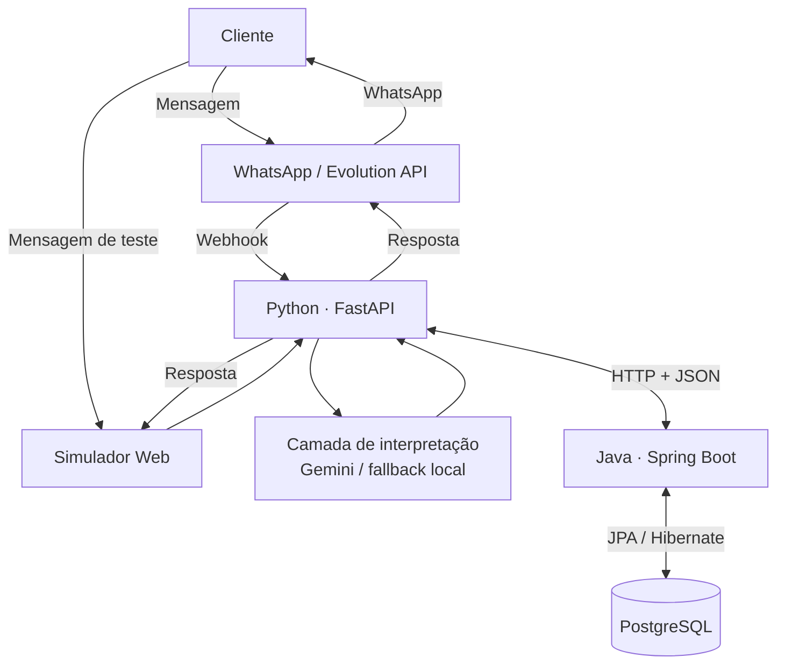

<div align="center">

# 🌱 CANA
### Assistente inteligente de delivery + gestão de mercadinho

**Do pedido em linguagem natural ao controle do estoque — em uma única solução.**

<p>
  
  
  
  
  
  
  
  
</p>

</div>

---

## ✨ Conheça o CANA

O **CANA** é um sistema de atendimento e apoio à gestão de pequenos mercados e mercadinhos. Seu objetivo é facilitar a criação de pedidos por meio de conversas naturais e oferecer à equipe uma área administrativa para acompanhar produtos, estoque e vendas.

O projeto reúne duas experiências que trabalham em conjunto:

- **Atendimento inteligente:** o cliente escreve como falaria com uma pessoa — por exemplo, “quero 2 kg de arroz e 3 unidades de leite”. O CANA interpreta a mensagem, organiza os itens e mantém a sacola atualizada.
- **CANA Admin:** a equipe acessa um painel para consultar o catálogo, cadastrar produtos conforme a permissão, movimentar o estoque, acompanhar o histórico e atualizar o andamento dos pedidos.

A proposta é reduzir tarefas manuais, organizar as informações recebidas e aproximar o atendimento digital da rotina operacional do estabelecimento.

## 🎯 Problema que o projeto busca resolver

Pedidos enviados por mensagens costumam chegar sem um padrão: quantidades em formatos diferentes, nomes abreviados, alterações ao longo da conversa e informações que precisam ser conferidas pela equipe. Ao mesmo tempo, o estabelecimento precisa manter preços, produtos e quantidades em estoque organizados.

O CANA propõe uma solução integrada: interpreta a conversa, estrutura os itens da sacola e centraliza os dados comerciais em uma API própria, com persistência em banco de dados. O painel administrativo complementa esse fluxo com ferramentas para a operação diária.

## 🧩 Funcionalidades

### 💬 1. Atendimento inteligente

- Recebe mensagens em linguagem natural pelo simulador web ou pelo WhatsApp conectado.
- Interpreta produtos, quantidades e unidades de medida.
- Reconhece pedidos para adicionar, remover ou alterar itens da sacola.
- Normaliza nomes de produtos e tenta relacioná-los ao catálogo cadastrado.
- Organiza os produtos por categorias, como Hortifruti, Mercearia, Açougue, Laticínios, Bebidas, Limpeza e Padaria.
- Mantém a sacola associada ao telefone do cliente, permitindo continuar a conversa sem recomeçar a lista.
- Gera uma resposta com o resumo atualizado e pode solicitar esclarecimentos quando a mensagem estiver incompleta ou ambígua.
- Conta com um mecanismo local de interpretação como alternativa quando a IA externa não estiver configurada ou falhar.

**Exemplo de conversa:**

```text
Cliente: Oi! Quero 2 kg de arroz e 3 unidades de leite.
CANA: Sua sacola foi atualizada com os produtos informados.

Cliente: Pode tirar o leite e colocar 1 kg de banana?
CANA: A sacola é atualizada com a alteração solicitada.
```

> O exemplo ilustra o tipo de interação esperado. A interpretação de mensagens mais livres depende da configuração do provedor de IA; o modo local oferece uma interpretação mais simples.

### 🧺 2. Simulador de atendimento web

O simulador permite testar o fluxo de conversa diretamente no navegador, sem precisar conectar um número de WhatsApp. Ele envia as mensagens ao backend, apresenta as respostas do CANA e mostra os itens extraídos para facilitar a conferência durante os testes.

A interface também permite remover itens manualmente da lista exibida.

### 📱 3. Integração com WhatsApp

A comunicação com o WhatsApp é feita por meio da **Evolution API**:

1. A instância do WhatsApp é criada e pareada por QR Code.
2. A Evolution API encaminha as mensagens recebidas para o webhook do CANA.
3. O backend Python processa a mensagem e consulta o serviço Java para recuperar e atualizar a sacola.
4. A resposta produzida pelo CANA é enviada de volta ao cliente pela Evolution API.

O webhook considera mensagens de texto individuais e ignora eventos que não fazem parte desse fluxo, como mensagens enviadas pela própria conta e mensagens de grupos.

### 🖥️ 4. CANA Admin — painel administrativo

O painel administrativo foi desenvolvido para apoiar a equipe do estabelecimento. Ele possui autenticação e controle de permissões por perfil.

| Área | O que permite fazer |
|---|---|
| **Visão geral** | Consultar quantidade de produtos ativos, itens com estoque baixo, pedidos pendentes e vendas de pedidos confirmados. |
| **Produtos** | Pesquisar por nome, categoria ou código; consultar preço, quantidade e estoque mínimo; cadastrar e editar produtos conforme a permissão do usuário. |
| **Estoque** | Registrar entradas, saídas e ajustes, informando a quantidade e o motivo da movimentação. |
| **Histórico** | Consultar as 100 movimentações mais recentes, incluindo data, produto, tipo, quantidade, saldo anterior e posterior, responsável e motivo. |
| **Pedidos e vendas** | Consultar os 100 pedidos mais recentes e atualizar seus status durante o processamento. |

#### Controle de permissões

O sistema possui dois perfis iniciais:

- **Administrador (`ADMIN`):** pode consultar o sistema, cadastrar e editar produtos, movimentar estoque e gerenciar pedidos.
- **Funcionário (`STAFF`):** pode consultar produtos, movimentar estoque, consultar o histórico e atualizar pedidos, mas não pode cadastrar ou editar produtos.

#### Regras importantes do estoque e dos pedidos

- Uma **entrada** soma uma quantidade ao saldo atual.
- Uma **saída** retira uma quantidade do saldo e é bloqueada quando não há estoque suficiente.
- Um **ajuste** define o saldo disponível para o valor informado.
- Toda movimentação exige um motivo e registra o usuário responsável.
- Ao mudar um pedido para **CONFIRMADO**, o sistema verifica a disponibilidade e registra a baixa dos itens no estoque.
- Um pedido confirmado pode avançar para **EM_PREPARACAO**, **SAIU_PARA_ENTREGA** e **CONCLUIDO**.
- Ao cancelar um pedido que já teve o estoque baixado, o sistema registra a reposição dos itens.

## 🖼️ Prévia visual do painel

As imagens abaixo mostram a organização visual das telas do CANA Admin. **Os números, nomes e registros exibidos nas prévias são dados ilustrativos**, utilizados para demonstrar a interface; não representam uma consulta a uma base de produção.

<p align="center">
  
</p>

<details>
<summary><strong>Ver telas em mais detalhes</strong></summary>

#### Visão geral
<p align="center"></p>

#### Catálogo de produtos
<p align="center"></p>

#### Cadastro de produto
<p align="center"></p>

#### Controle de estoque
<p align="center"></p>

#### Histórico de movimentações
<p align="center"></p>

#### Pedidos e vendas
<p align="center"></p>

#### Perfil de funcionário
<p align="center"></p>

</details>

## 🏗️ Arquitetura da solução

O CANA utiliza uma arquitetura dividida em serviços, com responsabilidades separadas:

- **Python + FastAPI:** recebe as mensagens, disponibiliza o simulador e o painel, coordena a interpretação da conversa e se comunica com o backend Java.
- **Java + Spring Boot:** centraliza as regras de negócio, validações, catálogo, estoque, carrinhos e operações de pedidos.
- **PostgreSQL:** armazena os dados comerciais, incluindo produtos, categorias, estoque, carrinhos, pedidos, usuários administrativos e movimentações.
- **Evolution API:** faz a integração entre o CANA e o WhatsApp.
- **Redis:** é utilizado pela infraestrutura da Evolution API para cache e sessões; não é o repositório dos carrinhos do CANA.
- **Gemini / OpenAI (opcional):** modelos externos podem ser usados para interpretar mensagens. Sem a chave do Gemini, o CANA utiliza seu mecanismo local de contingência, com recursos mais limitados.

### Diagrama de comunicação



### Fluxo de uma mensagem

1. O cliente envia uma mensagem pelo WhatsApp ou pelo simulador.
2. O FastAPI recebe o conteúdo e recupera a sacola vinculada ao telefone do cliente por meio da API Java.
3. O mecanismo de interpretação identifica a intenção e organiza os itens em uma estrutura de dados validada.
4. O CANA consulta o catálogo no backend Java para relacionar os itens aos produtos cadastrados.
5. A sacola atualizada é enviada ao Java e persistida no PostgreSQL.
6. O Python monta a resposta e a apresenta no simulador ou a envia ao WhatsApp pela Evolution API.

### Separação de responsabilidades

| Componente | Responsabilidade principal |
|---|---|
| `main.py` | Rotas HTTP, simulador, painel, webhooks e coordenação do atendimento. |
| `app/services.py` | Interpretação das mensagens, normalização dos itens e montagem das respostas. |
| `app/java_api.py` | Comunicação HTTP entre Python e Java. |
| `app/whatsapp.py` | Envio de mensagens pela Evolution API. |
| `backend-java/` | API Java, entidades, regras de negócio, autenticação e persistência. |
| `templates/` | Interfaces web do simulador e do CANA Admin. |
| `database/init/` e migrações Flyway | Estrutura inicial e evolução do banco de dados. |

## 🧰 Tecnologias utilizadas

| Tecnologia | Aplicação no projeto |
|---|---|
| **Python 3.12** | Camada de atendimento e integração. |
| **FastAPI** | API HTTP, rotas e webhooks. |
| **Pydantic v2** | Validação e estruturação dos dados de mensagens e listas. |
| **LangChain** | Integração com modelos de linguagem e saída estruturada. |
| **Google Gemini** | Interpretação inteligente de mensagens, quando configurado. |
| **Java 21** | Backend de regras de negócio. |
| **Spring Boot 3.5.3** | Construção da API Java. |
| **Spring Data JPA / Hibernate** | Mapeamento e persistência das entidades. |
| **PostgreSQL 15+** | Banco de dados relacional. |
| **Flyway** | Controle de migrações do banco. |
| **Evolution API 2.3.0** | Integração com WhatsApp. |
| **Redis 7** | Cache e sessões utilizados pela Evolution API. |
| **Docker Compose** | Inicialização coordenada dos serviços. |

## 🚀 Como executar no Windows

O modo recomendado para avaliação e execução local utiliza Docker Desktop. Nesse modo, não é necessário instalar Java e Maven diretamente no Windows, pois o backend Java é compilado dentro do contêiner.

### Pré-requisitos

- Windows com PowerShell.
- Docker Desktop instalado e em execução.
- Git, caso o projeto seja obtido por clone.
- Chave da API Gemini para habilitar a interpretação por IA (opcional para iniciar).

### 1. Preparar as configurações

Na pasta principal do projeto, crie o arquivo `.env` a partir do exemplo:

```powershell
Copy-Item .env.example .env
```

Abra o arquivo `.env` e configure, pelo menos, os valores que deseja utilizar. Para habilitar o Gemini, informe sua chave em `GEMINI_API_KEY`:

```env
GEMINI_API_KEY=sua_chave_gemini
```

Sem essa chave, o sistema continua podendo iniciar com o mecanismo local de interpretação, mas com capacidade mais limitada para entender mensagens livres. As configurações de WhatsApp também precisam estar preenchidas para realizar o pareamento e o envio de mensagens.

> **Atenção:** `.env.example` contém valores destinados ao desenvolvimento local. Não publique senhas, tokens ou chaves reais. O arquivo `.env` está listado no `.gitignore`.

### 2. Iniciar o CANA

Abra o PowerShell na pasta raiz do projeto e execute:

```powershell
.\iniciar-cana.ps1
```

O script cria o `.env` a partir do exemplo quando necessário e executa `docker compose up --build -d`, iniciando os serviços.

Na primeira execução, aguarde o Docker concluir o download e a construção das imagens.

Para conferir os contêineres:

```powershell
docker compose ps
```

### 3. Acessar o sistema

Com os serviços iniciados, utilize:

| Recurso | Endereço local |
|---|---|
| Simulador de atendimento | [http://localhost:8000](http://localhost:8000) |
| **CANA Admin** | [http://localhost:8000/admin](http://localhost:8000/admin) |
| Saúde do serviço Python | [http://localhost:8000/health](http://localhost:8000/health) |
| Prontidão Python + Java | [http://localhost:8000/ready](http://localhost:8000/ready) |
| Saúde da API Java | [http://localhost:8081/api/health](http://localhost:8081/api/health) |
| Evolution API | [http://localhost:8080](http://localhost:8080) |

### 4. Entrar no CANA Admin

As contas iniciais de demonstração são:

| Usuário | Perfil | Senha inicial |
|---|---|---|
| `nicolas` | Administrador | `123` |
| `pedro.lucas` | Funcionário | `123` |

As senhas são armazenadas com hash PBKDF2 e o token de sessão administrativa tem validade de 8 horas. As credenciais acima são provisórias e servem apenas para o ambiente de demonstração. Não exponha o painel publicamente com essas credenciais ou com os segredos padrão do `.env.example`.

### 5. Conectar o WhatsApp (opcional)

Com os serviços iniciados e as configurações da Evolution API preenchidas no `.env`:

1. Execute `.\gerar-qrcode.ps1` no PowerShell.
2. No WhatsApp do aparelho que será conectado, abra **Dispositivos conectados → Conectar dispositivo** e leia o QR Code.
3. Após o pareamento, execute `.\configurar-webhook.ps1` para apontar os eventos de mensagens à API do CANA.

A integração depende do pareamento válido e da configuração correta da instância e das chaves da Evolution API.

### 6. Parar os serviços

Para encerrar os contêineres sem remover os volumes de dados:

```powershell
.\parar-cana.ps1
```

Para iniciar novamente:

```powershell
docker compose up -d
```

**Não utilize `docker compose down -v` para uma parada comum**, pois a opção `-v` remove os volumes e pode apagar dados persistidos.

## 🧪 Testes

Os testes automatizados da camada Python ficam na pasta `tests/`. Para executá-los em um ambiente Python local:

```powershell
python -m venv .venv
.\.venv\Scripts\Activate.ps1
pip install -r requirements-dev.txt
pytest -v
```

## 📂 Estrutura do repositório

```text
Agente-de-Delivery/
├── app/                         # Atendimento, configuração e integrações Python
│   ├── config.py                # Variáveis de ambiente
│   ├── java_api.py              # Cliente HTTP para o backend Java
│   ├── estado.py                # Fachada para persistência dos carrinhos via Java
│   ├── schemas.py               # Modelos e validações Pydantic
│   ├── services.py              # Interpretação das mensagens e respostas
│   └── whatsapp.py              # Envio de mensagens pela Evolution API
├── backend-java/                # Backend Java com Spring Boot
│   ├── src/main/java/           # Controllers, serviços, entidades e repositórios
│   └── src/main/resources/      # Configuração e migrações Flyway
├── database/init/               # SQL de inicialização do PostgreSQL
├── templates/                   # Simulador e painel CANA Admin
├── tests/                       # Testes automatizados Python
├── docs/                        # Documentação técnica e materiais do projeto
├── docker-compose.yml           # Serviços e rede local
├── Dockerfile                   # Imagem do serviço Python
├── iniciar-cana.ps1             # Preparação e inicialização no Windows
├── parar-cana.ps1               # Parada dos serviços sem apagar volumes
├── gerar-qrcode.ps1              # Geração do QR Code do WhatsApp
├── configurar-webhook.ps1       # Configuração do webhook da Evolution API
├── requirements.txt             # Dependências Python de execução
├── requirements-dev.txt         # Dependências de desenvolvimento e testes
└── .env.example                 # Modelo de variáveis de ambiente
```

## ⚠️ Escopo atual e pontos de atenção

O CANA é um projeto acadêmico e uma base funcional de desenvolvimento. Para compreender corretamente o que está implementado nesta versão, é importante observar alguns limites:

- A conversa atualiza e persiste a **sacola** do cliente, mas ainda não transforma automaticamente essa sacola em um pedido formal confirmado. A API Java possui a operação de criação de pedidos; a etapa de confirmação explícita pelo cliente ainda precisa ser conectada ao fluxo conversacional.
- A inclusão de itens na sacola não reduz o estoque. A baixa acontece quando um pedido registrado é confirmado no painel/API.
- Os valores e quantidades do catálogo inicial são dados demonstrativos e precisam ser revisados para qualquer uso real.
- A interpretação local funciona sem uma chave de IA, mas é mais limitada do que a interpretação por modelo externo.
- A integração com WhatsApp exige configurar a Evolution API e parear uma conta por QR Code.
- As credenciais iniciais e os segredos de exemplo não são adequados para exposição pública ou produção. Uma implantação real exige troca dos segredos, HTTPS, controle de acesso à rede, backups e revisão de segurança.

## 🛣️ Possíveis evoluções

- Conectar a confirmação explícita do cliente à criação do pedido formal.
- Evoluir a experiência conversacional para consultar disponibilidade e apresentar informações comerciais com maior contexto.
- Ampliar os testes automatizados para os fluxos transacionais do backend Java.
- Adicionar recursos de relatórios e indicadores operacionais.
- Implementar fluxo de alteração de credenciais e administração de usuários.

## 👥 Equipe

Projeto desenvolvido em colaboração por **Nicolas** e **Pedro Lucas**.

---

<div align="center">

**CANA — tecnologia para deixar o atendimento mais simples e a gestão mais organizada.** 🌿

</div>
